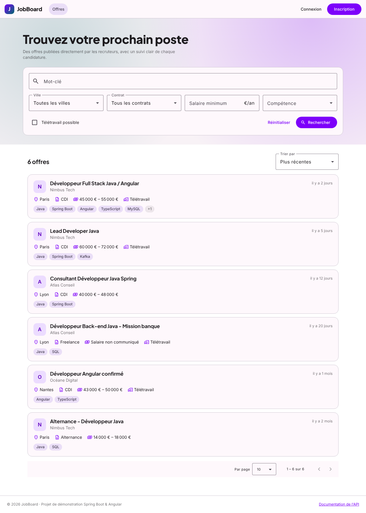
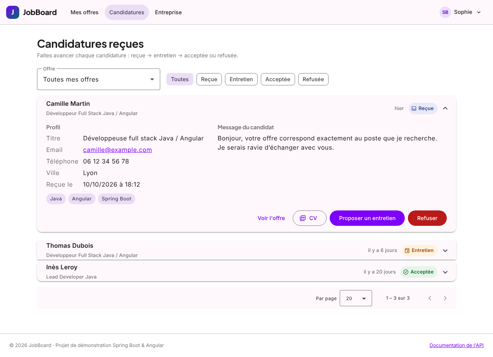
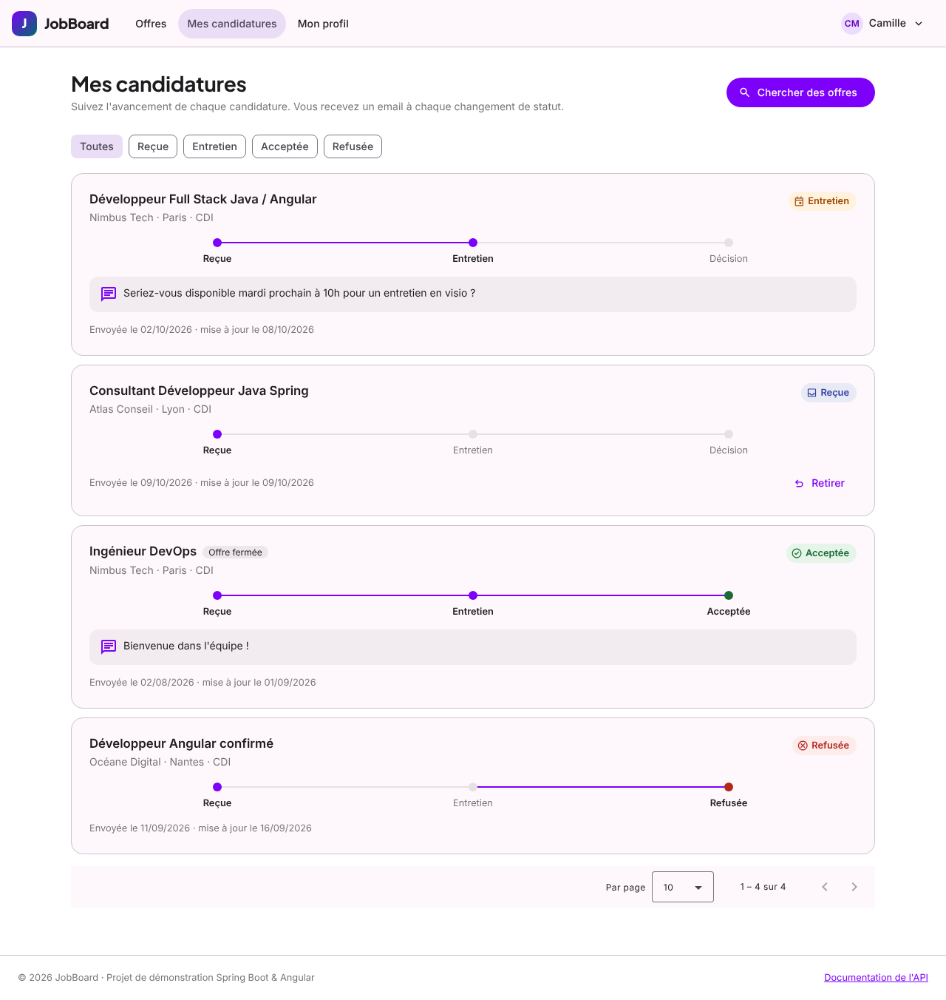
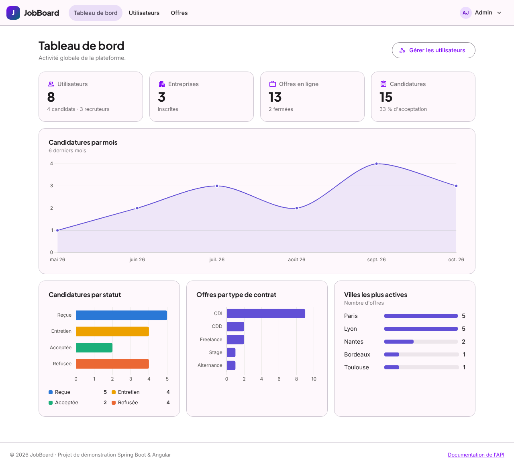
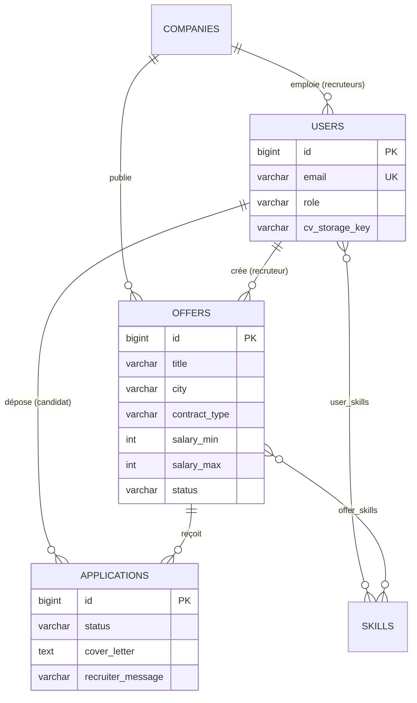

# JobBoard

Plateforme de recrutement full stack : les **candidats** cherchent des offres et postulent avec leur CV, les **recruteurs** publient leurs offres et font avancer chaque candidature, un **administrateur** supervise l'activité.

**Stack** : Java 25 · Spring Boot 4.1 · Spring Security (JWT) · Spring Data JPA · MySQL 8.4 · Flyway · Angular 22 · Angular Material · Docker.



---

## Fonctionnalités

| Rôle | Ce qu'il peut faire |
|---|---|
| **Visiteur** | Rechercher des offres (mot-clé, ville, contrat, salaire minimum, compétence, télétravail), trier, paginer, consulter une offre |
| **Candidat** | Gérer son profil et ses compétences, déposer son CV en PDF, postuler avec un message, suivre ses candidatures par statut, retirer une candidature encore « reçue » |
| **Recruteur** | Publier, modifier, fermer ou supprimer ses offres, voir le nombre de candidatures par statut, filtrer les candidatures reçues, télécharger les CV, faire évoluer chaque candidature avec un message au candidat, gérer la fiche entreprise |
| **Admin** | Tableau de bord (indicateurs, candidatures par mois, répartition par statut et par contrat, villes les plus actives), recherche et désactivation de comptes, modération des offres |

**Cycle de vie d'une candidature** : `Reçue → Entretien → Acceptée | Refusée` (un refus est aussi possible dès la réception). Le back-end refuse toute autre transition, et **un email est envoyé au candidat à chaque étape**, y compris la confirmation de réception.

| Espace recruteur | Suivi candidat | Administration |
|---|---|---|
|  |  |  |

---

## Démarrage rapide (Docker)

Prérequis : Docker et Docker Compose.

```bash
docker compose up --build
```

| Service | URL |
|---|---|
| Application | http://localhost:4200 |
| Swagger UI | http://localhost:8081/swagger-ui.html |
| Emails envoyés (Mailpit) | http://localhost:8025 |

Au premier démarrage, un jeu de démonstration est créé : 3 entreprises, 15 offres, 4 candidats avec un CV, 14 candidatures réparties sur 6 mois.

| Rôle | Email | Mot de passe |
|---|---|---|
| Candidat | `candidat@jobboard.dev` | `Password123!` |
| Recruteur | `recruteur@jobboard.dev` | `Password123!` |
| Admin | `admin@jobboard.dev` | `Admin123!` |

La page de connexion propose aussi ces comptes en un clic.

---

## Développement local

Prérequis : JDK 25, Maven 3.9+, Node.js 22.22.3+ ou 24 (exigé par Angular CLI 22).

```bash
# 1. Infrastructure seule (MySQL + Mailpit)
docker compose up -d mysql mailpit

# 2. API sur http://localhost:8080
cd backend
mvn spring-boot:run

# 3. Front sur http://localhost:4200 (les appels /api sont relayés vers le back par proxy.conf.json)
cd frontend
npm install
npm start
```

### Tests

```bash
cd backend  && mvn verify          # tests unitaires JUnit 6 / Mockito / AssertJ
cd frontend && npm run test:ci     # tests unitaires Vitest
```

Les deux suites tournent aussi à chaque push grâce à la CI GitHub Actions (`.github/workflows/ci.yml`).

### Configuration

Toutes les valeurs ont un défaut adapté au développement et se surchargent par variable d'environnement :

| Variable | Rôle | Défaut |
|---|---|---|
| `DB_URL`, `DB_USERNAME`, `DB_PASSWORD` | Connexion MySQL | `localhost:3306/jobboard`, `jobboard` / `jobboard` |
| `JWT_SECRET` | Clé de signature HS256 (32 octets minimum) | valeur de développement, **à changer en production** |
| `JWT_EXPIRATION` | Durée de validité du token | `2h` |
| `MAIL_HOST`, `MAIL_PORT`, `MAIL_ENABLED` | Serveur SMTP | `localhost`, `1025`, `true` |
| `CV_STORAGE_DIR` | Dossier de stockage des CV | `./storage/cv` |
| `ADMIN_EMAIL`, `ADMIN_PASSWORD` | Compte admin créé au démarrage s'il n'existe pas | `admin@jobboard.dev` / `Admin123!` |
| `SEED_DEMO_DATA` | Créer le jeu de démonstration si la base est vide | `true` |

---

## Architecture

```
jobboard/
├── backend/                     API REST Spring Boot
│   └── src/main/java/com/jobboard/
│       ├── auth/                inscription, connexion
│       ├── security/            configuration Spring Security, émission des JWT
│       ├── offer/               offres, recherche dynamique (Specification)
│       ├── application/         candidatures, cycle de vie, événements
│       ├── candidate/           profil candidat, CV
│       ├── company/  skill/  user/
│       ├── notification/        emails asynchrones
│       ├── admin/               statistiques, gestion des comptes
│       ├── storage/             stockage des fichiers
│       ├── common/              entité de base, pagination, gestion globale des erreurs
│       └── seed/                compte admin et jeu de démonstration
│   └── src/main/resources/db/migration/   migrations Flyway
├── frontend/                    SPA Angular
│   └── src/app/
│       ├── core/                modèles, services d'API, auth (service, intercepteurs, guards)
│       ├── shared/              composants, pipes et validateurs réutilisables
│       └── features/            pages par espace : offers, auth, candidate, recruiter, admin
├── docs/screenshots/
└── docker-compose.yml           MySQL + Mailpit + API + front (nginx)
```

### Modèle de données



Le schéma est entièrement versionné par Flyway (`V1__init_schema.sql`, `V2__seed_skills.sql`) : contraintes `CHECK` sur les énumérations, unicité `(offer_id, candidate_id)` pour empêcher les doublons de candidature, index sur les colonnes filtrées.

### Principaux endpoints

La documentation complète et testable est disponible dans Swagger UI.

| Méthode | Endpoint | Accès |
|---|---|---|
| `POST` | `/api/auth/register/candidate` · `/api/auth/register/recruiter` · `/api/auth/login` | public |
| `GET` | `/api/offers?keyword=&city=&contractType=&minSalary=&skillId=&remote=&page=&size=&sort=` | public |
| `GET` | `/api/offers/{id}` · `/api/offers/cities` · `/api/skills` · `/api/companies/{id}` | public |
| `GET` `PUT` | `/api/candidate/profile` | candidat |
| `POST` `GET` | `/api/candidate/cv` (multipart, PDF ≤ 5 Mo) | candidat |
| `POST` `GET` | `/api/candidate/applications` · `DELETE /api/candidate/applications/{id}` | candidat |
| `GET` `POST` `PUT` `DELETE` | `/api/recruiter/offers[/{id}]` · `PATCH /api/recruiter/offers/{id}/status` | recruteur |
| `GET` | `/api/recruiter/applications?offerId=&status=` | recruteur |
| `PATCH` | `/api/recruiter/applications/{id}/status` | recruteur |
| `GET` | `/api/recruiter/applications/{id}/cv` | recruteur |
| `GET` `PUT` | `/api/recruiter/company` | recruteur |
| `GET` | `/api/admin/stats` · `/api/admin/users?role=&search=` | admin |
| `PATCH` `POST` `DELETE` | `/api/admin/users/{id}/enabled` · `/api/admin/skills` · `/api/admin/offers/{id}` | admin |

Les erreurs suivent le format standard **RFC 9457** (`application/problem+json`) ; les erreurs de validation détaillent chaque champ dans `errors`.

---

## Choix techniques

**Back-end**

- **JWT avec le resource server de Spring Security** : le token est signé en HS256 par `NimbusJwtEncoder` et vérifié par le décodeur standard (signature, expiration, émetteur). Il n'y a pas de filtre maison. Le rôle porté par le token devient une autorité `ROLE_*`, contrôlée par préfixe d'URL (`/api/candidate/**`, `/api/recruiter/**`, `/api/admin/**`).
- **Contrôle d'appartenance dans les services** : un recruteur ne voit et ne modifie que ses propres offres et candidatures. Une candidature d'un autre recruteur renvoie 404 plutôt que 403, pour ne pas révéler son existence.
- **Règle métier dans le domaine** : `JobApplication.moveTo()` applique les transitions autorisées définies par l'énumération `ApplicationStatus`.
- **Emails découplés** : le service publie un `ApplicationStatusChangedEvent`. Un `@TransactionalEventListener(AFTER_COMMIT)` en `@Async` envoie l'email seulement si la transaction a réussi, sans ralentir la requête. Un échec SMTP ne fait pas échouer l'opération.
- **Recherche dynamique** avec l'API Criteria (`OfferSpecifications`) : chaque filtre optionnel ajoute un prédicat.
- **Performance JPA** : `open-in-view` est désactivé, les associations sont chargées paresseusement par lots (`default_batch_fetch_size`) et les statistiques sont calculées en base par `GROUP BY`.
- **Upload sécurisé** : la signature binaire `%PDF-` est vérifiée, le fichier est renommé avec un UUID et protégé contre le *path traversal*. La taille est limitée à 5 Mo.
- **Threads virtuels** Java activés (`spring.threads.virtual.enabled`).

**Front-end**

- **Composants standalone**, chargés à la demande par route (Chart.js n'est téléchargé que sur le tableau de bord admin).
- **Signals et détection `OnPush`**, en mode *zoneless* (sans zone.js).
- **Formulaires réactifs typés**, avec validateurs croisés : fourchette de salaire et confirmation du mot de passe. Les erreurs de validation renvoyées par l'API sont reportées sur les bons champs.
- **Intercepteurs fonctionnels** :
  - ajout du token, uniquement vers l'API ;
  - gestion centralisée des 401, 403 et 5xx.
- **Guards** :
  - `roleGuard` piloté par `data.roles` ;
  - `guestGuard` ;
  - mémorisation de la page demandée avant connexion, avec protection contre les redirections ouvertes.
- **Filtres de recherche dans l'URL** : une recherche peut être partagée ou rechargée.

---

## Pistes d'évolution

- Refresh token et révocation (liste de tokens invalidés à la désactivation d'un compte)
- Tests d'intégration avec Testcontainers (MySQL) et tests end-to-end Playwright
- Stockage des CV sur S3 / MinIO
- Templates d'emails HTML (Thymeleaf)
- Recherche plein texte (index FULLTEXT MySQL ou Elasticsearch)
